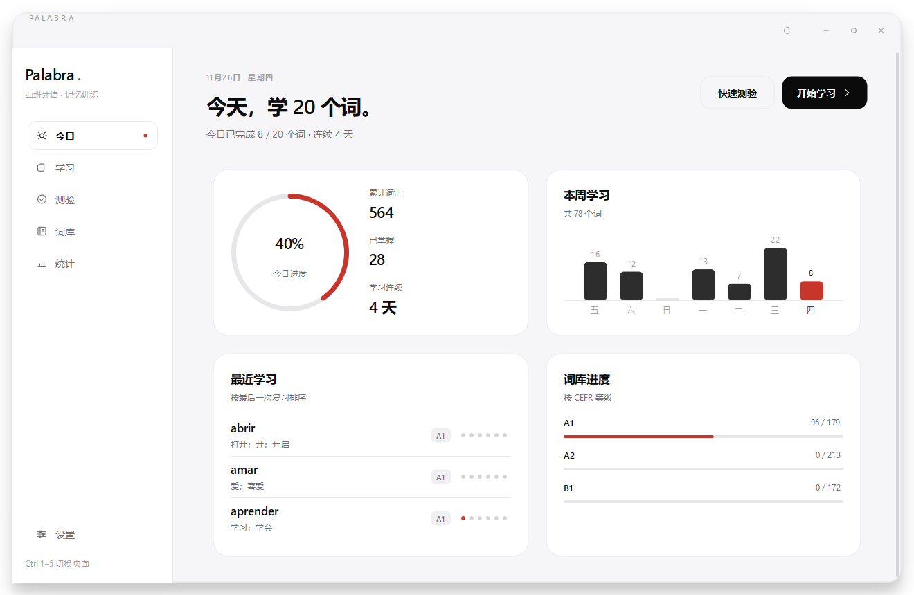

# Palabra · 背西班牙语单词

一款本地运行的西班牙语单词记忆桌面应用。Python + PySide6 全自绘界面，黑白色调，
参照 Apple 官网式的极简语言：大留白、精准排版、单一强调色、克制动效。

仓库：<https://github.com/Yukinoooooo589389/spanish-word-master>



---

## 1. 快速开始

```bash
git clone https://github.com/Yukinoooooo589389/spanish-word-master.git
cd spanish-word-master
pip install -r requirements.txt      # 只需要 PySide6-Essentials
python run.py
```

已经克隆到本地的话（比如 `D:\spainish`），直接在该目录执行 `python run.py` 即可。
Windows 下也可以直接双击 **`启动.bat`**。

环境要求：Windows 10/11、Python 3.10+、PySide6 6.6+。无需联网，无需数据库。

---

## 1.1 发给别人运行

仓库只保留源码，**不含打包产物**（`dist/` 已移除）。两种分发方式：

**方式 A（对方无需装 Python）**

在本地跑一次打包：

```bat
打包.bat
```

会在本地生成 `dist\Palabra\`（约 99 MB），压缩后约 **38 MB**，把它发给对方：

```
dist\Palabra\             ← 整个文件夹发过去（本地产物，不进仓库）
├─ Palabra.exe            ← 双击运行
├─ _internal\             ← 运行库 + 词库（不要删）
├─ 使用说明.txt
└─ userdata\              ← 首次使用后自动生成，进度存这里
```

已验证：把文件夹复制到任意目录、从任意工作目录启动都能正常运行。
首次打包会安装 PyInstaller 并需要联网，之后打包约 1 分钟。

**方式 B（直接发源码）**

对方机器上需要有 **Python 3.10+**。双击 `启动.bat`，脚本会检测 `PySide6`，
缺失时自动 `pip install`（**需要联网**）；没有 Python 时脚本会提示安装。

> 只发源码文件夹时，请忽略 `__pycache__`、`build`、`dist`、`userdata` 这几项。
> `dist/`、`build/`、`userdata/` 都已在 `.gitignore` 中忽略，正常 `git add` 不会带上它们。

---

## 2. 功能

| 模块 | 说明 |
|---|---|
| **今日** | 今日目标进度环、连续天数、本周学习柱状图、最近学习、词库进度 |
| **学习** | 翻卡式记忆：正面单词、背面释义与例句；三档自评（不认识 / 模糊 / 认识）驱动 Leitner 分层 |
| **测验** | 四选一，10 题一轮；答错立刻回到今日队列；结束后给出正确率 |
| **词库** | 564 个词，支持关键词搜索、CEFR（A1/A2/B1）与主题筛选、详情面板、朗读、加入今日复习 |
| **统计** | 累计/掌握/正确率、七日学习量、记忆分布、等级进度、28 天学习热力格 |
| **设置** | 每日目标、深浅外观、翻面朗读、本地数据目录、重置进度 |

其他：
- 深浅两套主题，所有自绘控件实时跟随，无需重启。
- 记忆调度：Leitner 五层 + 间隔 `1 / 2 / 4 / 7 / 15 / 30` 天；答错的词当天回到队列。
- 数据全部落在 `userdata/state.json`（可用环境变量 `PALABRA_USER_DIR` 改目录），随时备份或删除。
- 朗读使用 Windows 内置 SAPI，若系统装有西语语音会自动选用。

---

## 3. 键盘

| 键 | 行为 |
|---|---|
| `空格` / `回车` | 翻卡、下一题 |
| `1` `2` `3` | 不认识 / 模糊 / 认识（测验中为 A–D 选项） |
| `←` `→` | 跳过当前词 |
| `Esc` | 退出学习回到今日 |
| `Ctrl + 1…5` | 切换页面 |
| `Ctrl + ,` | 设置 |
| `Ctrl + K` | 聚焦词库搜索 |

---

## 4. 目录结构

```
spanish-word-master/        （本地可以放在任意目录，例如 D:\spainish）
├─ run.py                 启动入口（--selftest 自检）
├─ 启动.bat               双击启动（含环境检查）
├─ 打包.bat               打包成免安装 exe（PyInstaller）
├─ 使用说明.txt           随 exe 一起分发的说明
├─ DESIGN_SYSTEM.md       设计系统：色彩 / 排版 / 间距 / 动效 / 组件
├─ requirements.txt
├─ app/
│  ├─ theme.py            设计令牌 + 原生控件样式表
│  ├─ icons.py            24×24 线性图标（QPainter 现画，无图片资源）
│  ├─ widgets.py          自绘控件：按钮、卡片、分段、进度环、图表、翻卡、Toast
│  ├─ store.py            词库装载、Leitner 调度、进度持久化
│  ├─ tts.py              Windows SAPI 朗读
│  ├─ main.py             无边框外壳、标题栏、侧栏、页面路由、主题切换
│  └─ pages/              今日 / 学习 / 测验 / 词库 / 统计 / 设置
├─ data/words_*.json      词库（564 词，A1–B1，含例句）
├─ userdata/state.json    学习进度（首次运行自动生成，不入库）
├─ shots/                 界面截图
├─ tools/                 冒烟测试、截图脚本、交互自测、图标与批处理生成
├─ dist/                  打包产物（运行 打包.bat 后生成，不入库）
└─ .gitignore .gitattributes
```

---

## 5. 词库格式

`data/` 下所有 `words_*.json` 会被自动合并、去重：

```json
{
  "id": "a0001",
  "es": "la casa",
  "zh": "房子；家",
  "pos": "n.f.",
  "level": "A1",
  "theme": "居家",
  "ex_es": "Mi casa está cerca del parque.",
  "ex_zh": "我的家离公园很近。"
}
```

新增词库只要放进 `data/words_xxx.json` 并保持字段一致，重启即生效。

---

## 6. 设计系统

完整规范见 [`DESIGN_SYSTEM.md`](DESIGN_SYSTEM.md)。要点：

- **色彩**：`ink #0B0B0C` / `canvas #F6F6F8` / `surface #FFFFFF` / `slate #6E6E73`，唯一强调色 `accent #C8362B`（深色模式 `#E45B4D`）。
- **排版**：Display 46 → H1 30 → H2 22 → H3 17 → Body 14 → Caption 12 → Eyebrow 11，负字距只用于大字号。
- **间距**：4px 基准，页面左右 48，卡片内边距 20–28，块间 14–32。
- **圆角**：外壳 18 / 卡片 22 / 控件 14 / 胶囊 999。
- **动效**：hover 140ms、翻卡 420ms、页面淡入 240ms，只用减速曲线，不做循环动画。

所有颜色与尺寸只在 `app/theme.py` 定义一次，页面不允许写死数值。

---

## 7. 开发

```bash
python tools/smoke.py     # 离屏构建全部页面（无窗口环境可用）
python tools/shots.py     # 重新生成 shots/ 截图（使用临时 userdata，不污染真实进度）
python tools/interact.py  # 23 项自测：学习 / 测验 / 词库 / 设置 / 快捷键 / 持久化 / 无弹窗回归
python tools/make_icon.py # 生成 build/palabra.ico
python tools/make_bat.py  # 重新生成 启动.bat / 打包.bat（UTF-8 BOM + CRLF）
python run.py --selftest  # 打印词库与数据目录，验证打包是否完整
```

---

## 8. 常见问题

- **双击 `启动.bat` 窗口闪一下就没了**：批处理对编码/换行极敏感。本仓库的 `.bat` 一律由
  `python tools/make_bat.py` 生成（**UTF-8 with BOM + CRLF**）。若手工另存过，请重新生成一次：

  ```bash
  python tools/make_bat.py
  ```

  仍然异常时，在文件夹地址栏输入 `cmd` 回车，再执行 `启动.bat`，就能看到具体报错。
- **想确认环境是否正常**：`启动.bat --selftest`（或 `python run.py --selftest`）会打印词库条数与数据目录。
- **界面字体不像样**：应用优先使用 `Segoe UI` + `Microsoft YaHei UI`（Windows 自带）。
- **没有声音**：系统未安装西班牙语语音时仍会用默认语音朗读，音色可能偏英式。
- **想清空进度**：设置页「重置进度」需点两次确认，或直接删除 `userdata/state.json`。
- **窗口拖动/缩放**：无边框窗口，拖动标题栏移动；拖四边或四角缩放；双击标题栏最大化。